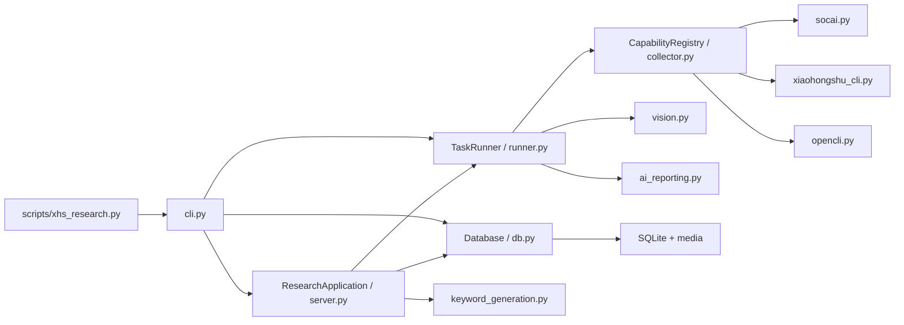
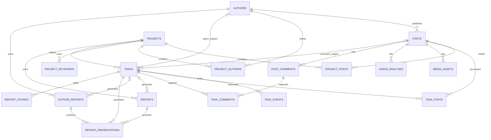
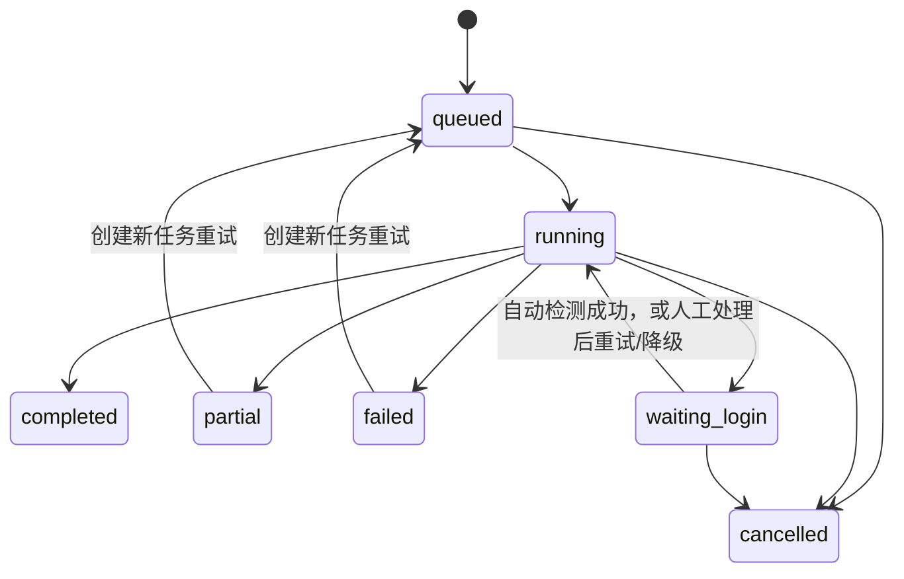

# xhs-research 系统架构

## 文档用途

本文记录当前实现中相对稳定的系统边界、核心数据关系和运行流程。只有需求涉及跨层边界、数据关系、任务状态、并发或 Provider 时，才读取对应小节；具体入口、实现文件和测试从 [CODEMAP.md](./CODEMAP.md) 定位。

本文不复制页面字段、完整接口参数或数据库列定义：

- 文档角色、阅读顺序和权威来源先看 [文档中心](./README.md)。
- 产品语义和默认行为以 [PRODUCT_RULES.md](./PRODUCT_RULES.md) 为准，页面空间布局以 [页面详细设计](./details/pages.md) 为参考。
- HTTP、服务和外部依赖细节从 [详细设计索引](./details/README.md) 进入。
- 实现层高风险约束以 [ENGINEERING_GUARDRAILS.md](./ENGINEERING_GUARDRAILS.md) 为准。
- 数据语义与刷新策略以 [data-model.md](./details/data-model.md) 为参考。
- 配置、采集器和运行环境以 [configuration.md](./details/configuration.md) 为参考。
- 发生冲突时，以当前代码、数据库约束和测试为准，并在同一任务中修正文档。

## 一、系统边界

`xhs-research` 同时提供对话命令入口和 Web 工作台，但二者不是两套系统：

```text
Codex / 命令行入口 ─┐
                    ├─> 本地 HTTP 服务 ─> SQLite + 媒体目录
浏览器 Web 工作台 ──┘          │
                               ├─> 数据采集 CLI
                               └─> Codex 关键词 / 图片理解 / 报告
```

核心结论：

- 对话入口和 Web 入口通过同一 HTTP API 创建项目、任务和关系。
- SQLite 是项目、作者、帖子、任务、报告和设置的事实来源。
- 前端不复制服务端业务状态；服务端状态统一通过 React Query 获取和失效。
- Web 生产页面来自已构建的 `web/dist/`，Python 服务不直接运行前端源码。
- 主 worktree 与 linked 开发 worktree使用不同端口和数据目录，运行环境按 worktree 类型识别。

## 二、运行时组成

### 启动链

1. 薄入口 [scripts/xhs_research.py](../scripts/xhs_research.py) 识别 worktree，设置默认端口和数据目录，并通过 HTTP 提供命令能力。
2. [cli.py](../scripts/workbench/xhs_research/cli.py) 构建数据库、采集器、Codex Provider、任务执行器和 HTTP 应用。
3. [server.py](../scripts/workbench/xhs_research/server.py) 取得数据目录生命周期锁，恢复中断任务，提供 API、媒体和静态前端。
4. [runner.py](../scripts/workbench/xhs_research/runner.py) 执行普通调研、批量更新、图片理解和报告任务。
5. [db.py](../scripts/workbench/xhs_research/db.py) 管理 SQLite 初始化、兼容迁移、事务和查询。

### 进程内模块关系



`ResearchApplication` 负责 HTTP 边界、任务创建、线程池、恢复、取消和生命周期；`TaskRunner` 负责业务执行；`Database` 负责一致性与持久化。

## 三、前端架构

前端位于 [scripts/workbench/web](../scripts/workbench/web)，使用 React 19、Ant Design Pro、Umi Max、TypeScript、React Query 和 Vitest。

### 分层

| 层 | 目录 | 职责 |
|---|---|---|
| 路由与布局 | `web/config/`、`web/src/app.tsx` | Hash 路由、导航、主题、全局布局 |
| 页面 | `web/src/pages/` | 读取路由参数，组合查询、操作和业务模块 |
| 业务功能 | `web/src/features/` | 作者、帖子、项目关系、报告、调研、任务、图片理解的共享交互 |
| 通用组件 | `web/src/components/` | 查询状态、任务状态、进度、成功反馈和错误边界 |
| 数据访问 | `web/src/services/` | HTTP 请求封装和 React Query key |
| 类型与纯函数 | `web/src/types.ts`、`web/src/utils/` | API 契约、导航、格式化、轮询与判断 |

### 数据流

```text
路由页面
  ├─ useQuery(queryKeys.*) ──> apiService.* ──> /api/*
  ├─ useMutation(apiService.*)
  └─ 组合 features 中的共享业务组件

操作成功
  └─ invalidate/remove query keys
      └─ 页面重新读取真实服务数据
```

活跃任务才轮询；轮询期间保留上一次成功数据。共享列表能力应优先修改 `features`，页面只提供上下文差异。

## 四、后端架构

### HTTP 与应用编排

[server.py](../scripts/workbench/xhs_research/server.py) 同时承担：

- 回环地址、`Host`、`Origin`、JSON 类型和请求体大小校验。
- `/api/*` 路由与错误响应。
- `/media/*` 安全读取和前端静态文件托管。
- 各任务类型执行器、项目内顺序约束、任务恢复和安全停止。
- 项目、关系、设置、关键词建议和数据发布等应用级编排。

HTTP handler 本身应保持为输入解析和结果返回；跨数据库与执行器的业务动作放在 `ResearchApplication` 或明确的服务对象中。

### 业务执行

[runner.py](../scripts/workbench/xhs_research/runner.py) 的主要职责：

- 将调研请求拆成原子采集能力并按路由降级。
- 把采集结果标准化并写入全局作者、帖子、媒体和项目关系。
- 执行项目作者批量更新和帖子详情定向更新。
- 建立报告证据快照，生成不调用外部 Provider 的描述性数据摘要，或运行大模型报告。
- 选择图片理解候选，OCR 固定调用 RapidOCR、大模型理解固定调用 Codex，并保存当前缓存结果；后台设置可从 Codex 本机模型目录选择模型、推理强度和超时，但任务与设置不提供 Ollama 或其他图片 Provider 路由。
- 写入任务阶段、进度、警告、事件和最终摘要。

### 数据访问

[db.py](../scripts/workbench/xhs_research/db.py) 是唯一数据库访问层，包含：

- Schema 初始化和旧库兼容迁移。
- 全局实体 upsert、项目关系和关键词维护。
- 服务端分页、筛选、排序和轻量统计。
- 任务创建、状态更新、事件、恢复、取消和重试所需事务。
- 数据摘要版本、报告占位版本、证据快照、批次缓存和原子提交。
- 项目删除和开发数据发布的一致性约束。

新增持久化行为应先判断能否放进现有事务，不要在 HTTP handler 中拼接零散 SQL。

## 五、核心数据模型

数据库 Schema 位于 [schema.sql](../scripts/workbench/xhs_research/schema.sql)，兼容迁移位于 `Database.initialize()`。



### 不可破坏的边界

- `authors` 和 `posts` 是全局主数据，项目只维护关系，不复制实体。
- 关联帖子时同步关联其作者；解除关系不删除全局实体。
- `tasks.project_id` 可空；作者资料更新、作者图片理解和作者报告通过 `tasks.author_id` 归属作者，评论采集通过 `tasks.post_id` 归属单条帖子，普通独立采集任务仍可不关联项目、作者或帖子。
- 评论用户是评论快照属性，不提升为全局作者；`post_comments` 按 `(post_id, comment_id)` 去重，`task_comments` 固定每次评论任务实际抓到的页面快照，`post_comment_checkpoints` 按帖子保存可失效的后续 cursor 与累计补充页数。
- 任务输入保存在 `input_json`，执行结果和可恢复进度保存在 `result_json` 与 `task_events`。
- 图片理解结果是否“当前有效”由图片范围、媒体内容、模型、推理强度和 Prompt 版本共同决定；`cover` 与 `detail` 可同时存在，旧记录以 `all` 保持兼容。超时只控制执行，不参与缓存身份。
- 项目报告和作者报告分别维护“数据摘要 / 大模型报告”版本。数据摘要是同一 SQLite
  读快照上的确定性描述统计；手动生成不创建任务，数据更新任务可以在自身完成事务中附带提交同结构摘要而不创建额外任务。大模型报告的生成中版本从任务创建时即可追踪。
- 大模型报告可同时冻结一个历史数据摘要与任务启动时的当前明细；两种来源保留各自时间点。`report_presentations` 绑定一份已完成文字报告，保存结构化幻灯片和可信模板渲染的自包含 HTML，删除源报告时级联删除。
- 设置保存在 `app_settings`，新任务需要快照的配置必须复制进任务输入或结果。

## 六、任务模型与并发

### 任务类型

| `task_type` | 执行器 | 典型操作 |
|---|---|---|
| `research` | `research_executor` | 普通调研、作者更新、项目作者批量更新、帖子详情更新 |
| `vision` | `vision_executor` | 项目或作者范围的图片理解、OCR 补充 |
| `ai_report` | `report_executor` | 项目或作者大模型文字报告、文字报告的 HTML 演示稿 |
| `keyword_suggestions` | `keyword_executor` | 项目 AI 关键词候选生成 |
| `comments` | `research_executor` | 单条帖子的分页评论采集 |

### 状态



服务重启时，`queued` 和 `waiting_login` 按原任务恢复；遗留的 `running` 为避免重复外部工作而转为 `failed`，由用户手动重试。

调度规则：

- 普通采集默认全局单线程。
- 不同项目、不同任务类型可按执行器容量并行。
- 同一项目的图片理解和报告可以并行。
- 同一项目只要前序或当前任务包含 `research`，就按创建顺序互斥。
- 同一项目最多一个活跃图片理解任务和一个活跃报告任务，最终由数据库唯一约束保证。
- 同一作者最多一个活跃图片理解任务和一个活跃报告任务，个人入口复用作者范围；全局帖子不提供图片理解任务入口。
- 同一项目最多一个活跃关键词建议任务；该任务使用独立执行器并沿用统一取消、恢复和事件模型。
- 同一帖子最多一个活跃评论采集任务；评论任务复用采集执行器和统一取消、登录等待、恢复、失败与重试模型。继续补充逐页原子更新业务数据与检查点；重新更新不影响有效深度检查点。

## 七、采集能力路由

[collector.py](../scripts/workbench/xhs_research/collector.py) 定义业务能力、稳定指令 ID、默认路由和校验。具体 Provider：

- [socai.py](../scripts/workbench/xhs_research/socai.py)
- [xiaohongshu_cli.py](../scripts/workbench/xhs_research/xiaohongshu_cli.py)
- [opencli.py](../scripts/workbench/xhs_research/opencli.py)

Runner 只调用“搜索帖子”“读取作者资料”“读取帖子详情”“读取帖子评论”等业务能力：

```text
业务动作
  ↓
CapabilityRegistry
  ↓
默认指令 ─普通失败→ 降级指令 1 ─普通失败→ 降级指令 2
  │
  └─登录/验证→ waiting_login ─人工完成→ 重试当前指令
                                      ├─成功→ 继续
                                      └─失败→ 下一降级指令
  ↓
标准化结果 + 实际路由快照 + 使用诊断
```

人工阻塞优先于能力降级：受控自动检测仍返回登录或验证要求时保持等待；只有当前指令在人工恢复后的重试仍失败，才记录人工重试失败并继续下一候选。每个后备指令都应用相同规则。

新任务不得绑定整任务采集引擎。新增 Provider 时扩展指令目录和适配器，不把 Provider 判断散落到前端或任务模型。

## 八、Codex 增强能力

- [keyword_generation.py](../scripts/workbench/xhs_research/keyword_generation.py)：在持久化 `keyword_suggestions` 任务中生成临时关键词候选；结果需用户确认后才写入项目关键词。
- [vision.py](../scripts/workbench/xhs_research/vision.py)：图片候选选择、批量结构化理解和缓存键。
- [ai_reporting.py](../scripts/workbench/xhs_research/ai_reporting.py)：证据选样、分批摘要、缓存、语义校验修复和最终合成。
- [codex_process.py](../scripts/workbench/xhs_research/codex_process.py)：统一处理 Codex 子进程超时、取消和清理。

这些能力共享“任务或请求取消后不得遗留子进程”的运行时约束。

图片理解模型目录由服务端调用配置中的 Codex CLI 读取，只返回可见且接受图片输入的模型及其推理强度；浏览器不直接调用 CLI。后台设置写入 `app_settings`，新任务将模型、推理强度和超时复制到 `input_json.image_analysis`，Runner 全程使用该冻结值，历史任务缺失时按跟随 Codex 默认模型、模型默认推理强度和 600 秒兼容。

## 九、安全与运行环境

- HTTP 服务只监听回环地址并校验回环 `Host`。
- 浏览器写请求必须来自可信本机 `Origin`；CLI 可以不带 `Origin`。
- `/media/` 只返回数据库登记、位于规范数据目录且内容确认为媒体的文件。
- 每个数据目录只能由一个服务进程持有生命周期锁。
- Python 服务、接口或运行时配置改变后，需要在无活跃任务时重启并进行真实运行时验收。
- 前端源码变更后需要构建 `web/dist/`，真实服务只托管构建产物。

## 十、文档维护

以下变化需要同步更新本文：

- 系统边界、运行时组件或模块职责变化。
- 核心实体、关系、任务类型、状态或并发规则变化。
- 新增外部 Provider、独立执行器或新的持久化子系统。

仅接口或模块细节变化且稳定边界不变时更新 [详细设计](./details/README.md)；仅文件移动、路由入口或测试归属变化通常只更新 [CODEMAP.md](./CODEMAP.md)。完成更新后运行：

```bash
python3 scripts/validate_architecture_docs.py
```
