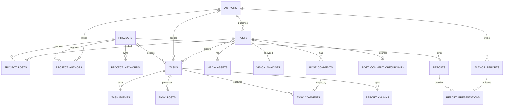

# 数据模型详细设计与刷新策略

## 核心实体

- `authors`：全局作者最新资料，每个小红书作者 ID 唯一。
- `posts`：全局帖子最新资料，每个小红书帖子 ID 唯一。
- `projects`：调研项目基础信息。创建项目时只保存名称、类型、说明和必要元数据，不保存采集参数。
- `project_authors`、`project_posts`：项目和全局实体的多对多关系。项目详情可从全局主数据中手动批量关联尚未加入当前项目的帖子或作者；手动关联只写关系，不创建采集任务、不复制主数据。关联帖子时还会把帖子作者以 `post_author` 关系加入项目，直接关联作者使用 `manual` 关系。
- `project_keywords`：项目关键词库，按 `(project_id, normalized_keyword)` 唯一。`source` 只使用 `manual` 或 `ai_generated`；同一个词同时以两种方式添加时保留 `manual`，表示用户明确确认过该词。AI 候选生成结果不存入本表，只有用户确认添加后才写入。
- `tasks`、`task_events`：两个入口共用的任务及进度事件。任务可通过 `project_id`、`author_id` 或 `post_id` 归属项目、作者或单条帖子；`task_type` 使用 `research`、`vision`、`ai_report`、`keyword_suggestions`、`comments`，评论任务的 `mode=post`，`created_from` 只表示发起入口。
- `post_comments`、`task_comments`、`post_comment_checkpoints`：分别保存帖子累计评论快照、任务页面关系，以及每帖唯一的后续 cursor/累计补充页数。回复预览可被完整楼中楼数据幂等升级；评论用户不进入 `authors`。
- `media_assets`：本地图片、原始地址、哈希和 OCR 结果。
- `vision_analyses`：按图片哈希、模型和提示词版本缓存的读图结果。
- `reports`：保存项目的数据摘要和大模型报告。数据摘要在同一 SQLite 读快照中计算描述性统计，`task_id` 为空，按 `generator_type=template` 独立递增版本；普通调研任务生成的历史模板报告继续兼容读取。大模型报告在任务创建事务中先写入 `generating` 占位版本，完成后原位更新；失败或取消时删除占位版本。
- `author_reports`：保存普通作者与“个人”的数据摘要和大模型报告。数据摘要不依赖任务，证据范围是该作者及其全局已采集帖子；大模型报告对应任务的 `project_id` 为空、`author_id` 指向作者，数据库部分唯一索引保证同一作者最多只有一个活跃报告任务。两类生成器独立维护版本，只有大模型报告采用 `generating → completed` 原位更新和失败删除规则。
- `report_chunks`：大模型报告内部的结构化证据批次。每行归属一个 `ai_report` 任务，记录批次序号、输入哈希、状态、尝试次数、输入字符数、结构化结果、诊断和错误摘要；`cache_key` 索引用于在后续相同证据、模型和 Prompt 版本的报告任务中复用已完成批次。
- `report_presentations`：一份已完成项目或作者大模型报告的 HTML 演示稿版本。项目报告外键与作者报告外键必须且只能有一个；任务创建时写入 `generating` 占位，完成后原位保存受约束的 `slides_json` 与服务端渲染的自包含 `html_content`，失败或取消时删除占位，删除源报告时级联清理。
- `app_settings.my_author_id`：可空的全局作者主键，表示“个人”入口当前固定展示的作者。首次选择已有作者只写该设置；首次输入新作者 ID 时先创建或复用全局作者，再创建一项无项目的 `basic_info` + `preview_posts` 更新任务。配置完成后的作者更换只修改该设置，不复制作者、帖子或报告数据。

## 表、关键字段与约束目录

精确物理列、默认值和 SQL 约束以 [schema.sql](../../scripts/workbench/xhs_research/schema.sql) 与 `Database.initialize()` 的兼容迁移为准。下表用于详细设计和影响分析，不能代替迁移实现。

| 表 | 关键字段 | 主键 / 唯一约束 | 关系、索引与删除语义 |
| --- | --- | --- | --- |
| `authors` | author_id、xhs_id、display_name、profile_url、bio、ip_location、粉丝/关注/获赞收藏、头像、抓取时间 | id PK；author_id UNIQUE | 作者删除级联项目作者和作者报告；帖子关系按显式业务控制 |
| `posts` | note_id、author_id、title、content、note_type、note_url、封面、发布时间、互动数、detail_level、content_hash、抓取时间 | id PK；note_id UNIQUE | author_id → authors；作者帖子索引；第一版不保留互动历史快照 |
| `projects` | name、slug、description、research_type、status、config_json、latest_report_id、时间 | id PK；slug UNIQUE；research_type CHECK | 删除级联关系和报告，已结束 tasks.project_id 置空 |
| `project_posts` | project_id、post_id、first_task_id、发现时间、精选、热度、备注 | (project_id, post_id) PK | 项目或帖子删除级联；解除关系不删帖子 |
| `project_authors` | project_id、author_id、relation_type、first_task_id、发现时间、备注 | (project_id, author_id, relation_type) PK | 项目或作者删除级联；来源关系可叠加 |
| `project_keywords` | project_id、keyword、normalized_keyword、source、时间 | id PK；(project_id, normalized_keyword) UNIQUE | 项目删除级联；手动来源覆盖同词 AI 来源 |
| `tasks` | 主体外键、task_type、mode、created_from、input_json、status、phase、progress、error、result_json、生命周期时间 | id TEXT PK；类型/模式/来源 CHECK | 主体删除时部分外键置空；部分唯一索引限制同主体活跃任务 |
| `task_events` | task_id、phase、event_type、payload_json、created_at | id PK | task_id + id 索引支持增量轮询；任务删除级联 |
| `task_posts` | task_id、post_id、source_type、source_value、source_rank | 四字段复合 PK | 任务或帖子删除级联；保存发现和处理来源 |
| `post_comments` | post_id、comment_id、层级、类型、作者快照、content、属地、互动、状态、时间 | id PK；(post_id, comment_id) UNIQUE | 帖子删除级联；评论用户不进入 authors |
| `task_comments` | task_id、post_comment_id、page_number、page_rank、is_reply_preview | (task_id, post_comment_id) PK | 任务或评论删除级联；任务页码顺序索引 |
| `post_comment_checkpoints` | post_id、next_cursor、status、completed_pages、last_task_id、last_error、时间 | post_id PK | 帖子删除级联；任务删除时 last_task_id 置空 |
| `media_assets` | post_id、media_index、media_type、远程/本地位置、sha256、文件大小、OCR、下载状态 | id PK；(post_id, media_index, media_type) UNIQUE | 帖子删除级联；本地路径必须位于当前数据目录 |
| `vision_analyses` | post_id、cache_key、model、prompt_version、image_scope、analysis_json、is_current | id PK；(post_id, cache_key) UNIQUE | 各图片范围独立维护 current；帖子删除级联 |
| `reports` | project_id、task_id、version、生成器身份、status、摘要/正文、证据规模、模型、快照、配置 | id PK；(project_id, version) UNIQUE | 项目或任务删除级联；成功提交才更新 latest_report_id |
| `author_reports` | author_id、task_id、version、生成器身份、status、摘要/正文、证据、模型、快照 | id PK；(author_id, version) UNIQUE | 作者或任务删除级联；同作者最多一个活跃报告任务 |
| `report_chunks` | task_id、chunk_index、cache_key、status、attempts、input_chars、result、diagnostics、error | id PK；(task_id, chunk_index) UNIQUE | cache_key + 状态索引；任务删除级联 |
| `report_presentations` | 源报告二选一、task_id、version、status、page_mode、slides_json、html_content、模型、配置 | id PK；每个源报告内 version UNIQUE | 源报告必须且只能二选一；源报告或任务删除级联 |
| `app_settings` | key、value_json、updated_at | key PK | 只保存设置，不保存 Cookie、Token 或账号隐私 |
| `data_releases` | source/target、status、summary_json、生命周期时间、error_message | id TEXT PK；status CHECK | created_at 索引；发布不删除目标数据 |

## 实体关系

## 刷新规则

列表发现每次执行，用于发现新帖并更新点赞等可见字段。帖子详情在最近成功获取时间超过配置的有效期（默认 30 天）、内容哈希变化或用户强制刷新时重新获取。作者扩展资料在最近成功获取时间超过配置的有效期（默认 7 天）时更新；作者列表中每次可见的名称、主页链接等基础字段仍随任务更新。媒体、OCR 与读图结果只在哈希或处理版本变化时重算。

刷新策略保存在应用设置中。任务开始时读取最新策略，因此后台修改会作用于下一项新任务，不追溯修改运行中的任务。作者任务还会应用可配置的单作者帖子上限，默认 300，但该配置不设系统固定上限。

服务启动时会检查帖子封面、作者头像和媒体资源的本地绝对路径。如果数据库来自另一套数据目录，而同一 `media/...` 相对位置的文件已经存在于当前 `XHS_RESEARCH_DATA_DIR`，服务会把数据库路径安全重定位到当前目录；当前目录没有对应文件时保持原值，不跨数据目录直接提供文件。前端封面按“当前本地文件 → 远程封面 → 占位图”回退，避免失效的 CDN 地址留下破图。

作者任务的 `source.author_ids` 保存一个或多个稳定作者 ID，`source.user_keywords` 保存用于发现用户的关键词，`user_limits.discovery` 保存所有用户关键词合计最多新增的作者数。Runner 先调用 `search_users_by_keyword`，再将稳定作者 ID 交给 `list_author_posts`；任务有关联项目时，才把返回资料以 `keyword_discovered` 关系关联到项目。关键词任务的帖子与作者采集由来源数组独立表达：开启帖子时写入 `source.keywords`，开启作者时把同一组输入写入 `source.user_keywords`，允许只保留其中一组，但不能同时为空。关键词作者的 `user_limits.discovery` 最少为 1、不设固定上限，默认 5，不受后台单次显式作者来源上限影响；`xiaohongshu-cli` 每页请求 20 位用户并按稳定作者 ID 去重，达到数量、返回不足一页或当前页没有新增结果时停止。关键词发现的作者不会继续读取主页帖子。历史综合任务使用 `mode=mixed`，同时保存 `source.keywords`、`source.user_keywords`、`source.author_ids`、`keyword_limits`、`user_limits`、`author_limits` 和 `topic`；Runner 按原任务确认来源执行，不自动生成下一轮来源，新建入口不再公开该模式。

作者模块的单作者更新任务仍使用 `mode=author`，并在 `author_update.scopes` 保存 `basic_info`、`preview_posts`、`detailed_posts` 中至少一项。该配置只允许一个显式作者 ID，不接受用户关键词。作者列表的 `basic_info` 调用 `read_author_profile` 并绕过作者资料 TTL，不读取帖子；作者详情的 `preview_posts` 调用 `list_author_posts`，以 `limits.discovery` 作为批量预览数量；请求超过 30 篇且当前路由包含 `xiaohongshu-cli` 时，本次任务临时优先使用其分页指令，避免只保存 Socai 首批 30 条。`detailed_posts` 调用 `read_author_post_details`，以 `limits.deep` 作为逐篇详情数量。帖子预览与详情结果中的署名不得覆盖作者基础资料；前端默认只选择 `preview_posts`，用户明确需要正文、收藏、评论或完整媒体时再选择 `detailed_posts`。

帖子详情更新任务仍使用 `task_type=research`，并以 `input_json.operation=post_detail_update` 区分普通发现任务。选中模式保存用户明确选择的帖子 ID；批量模式先按全局、项目或作者范围以及详情状态筛选，再在任务创建事务前固定最多 500 篇帖子及必要的 `note_id`、原文地址快照。Runner 逐篇调用 `read_post_detail`，不重新发现帖子、不改变项目或作者关系；只有详情返回且封面已下载为数据目录内的有效图片才算成功，直接封面下载失败时通过 `download_media` 兜底并只保留第一张有效图片作为封面，正文其他媒体允许仅保存远程地址。成功后更新 `posts`、`media_assets` 和 `last_detail_fetched_at`；封面未落地时记录逐篇失败且不刷新成功时间。任务通过 `task_posts` 记录本次实际处理对象，`result_json` 保存完成帖子 ID、逐篇失败、批次进度和能力路由，供暂停后继续与任务详情展示。

帖子 OCR 派生状态统一为三类：存在本地媒体且仍有媒体缺少 `ocr_completed_at` 时为 `pending`，存在本地媒体且全部完成时为 `completed`，当前没有可执行本地媒体时为 `other`。服务端分页筛选、全局/项目/作者列表和 OCR 任务弹窗共用这一口径；`other` 不进入 OCR 候选，后续封面成功落地后会自动转为 `pending`。

新任务不保存任务级 `collector`。历史任务中的该字段可以读取，但重跑时忽略。能力目录定义业务语义，采集指令目录通过稳定指令 ID 把语义映射到提供方方法和 CLI 命令模板，`app_settings.capability_routes` 保存每个能力的默认指令与有序降级指令。Runner 在任务开始时读取一次路由：默认指令成功后立即返回，失败时才尝试下一条。任务结果的 `routing_mode=capability`，`capability_usage` 记录最终 `selected_provider` 与 `selected_command`，`capability_routes` 保存实际路由快照，`collector_usage` 汇总各提供方调用。普通调研任务的 `image_analysis.mode` 固定为 `ocr-only`。

历史综合调研中的作者关系区分 `post_author` 与 `research_source`：前者表示作者随帖子被发现，后者表示用户明确把该作者选作主页采集来源。

独立图片理解任务使用 `task_type=vision`，同时在 `input_json.operation` 中保留 `vision` 作为输入快照，并记录 `image_scopes`、`vision_ratio`、`vision_count`（最低处理数量）、`vision_max_count`（最高处理数量）和 `vision_batch_size`（每批帖子数）的配置快照。大模型理解任务还冻结 `vision_model`、`vision_reasoning_effort` 和 `vision_timeout_seconds`；历史任务缺失时分别按跟随 Codex 默认模型、模型默认推理强度和 600 秒兼容，重试不得改读后台新值。OCR 任务不保存也不使用这三个字段。`image_scopes` 是 `cover/detail` 的非空复选，默认 `cover`；`detail` 包含除 `cover` 外的正文图片和视频封面帧。历史任务缺失该字段时按 `all` 执行。任务不创建新的项目帖子关系、不调用数据采集 CLI，也不生成或覆盖报告；只对范围内已有本地媒体补充 OCR 或 `vision_analyses`。选择性任务按每个所选范围分别计算候选数量；全量任务直接处理所选范围的全部未分析图片。候选帖子按 `vision_batch_size` 分批；相同范围和图片哈希可复用分析内容，但每个帖子仍保存独立关联。

大模型报告任务使用 `task_type=ai_report`，AI 关键词建议使用 `task_type=keyword_suggestions`，评论采集使用 `task_type=comments`，普通采集和更新调研任务使用 `task_type=research`。更新调研的配置来源只允许选择 `research`。旧数据库初始化时根据 `input_json.operation` 回填历史任务类型；没有 `operation` 的历史任务按 `research` 处理。

评论采集只接受单个 `post_id` 和每任务 1～20 页。继续补充从 `post_comment_checkpoints.next_cursor` 起步，评论页入库与检查点推进在同一事务内完成；重新更新从首页起步并保留有效深度检查点。任务输入不保存含 `xsec_token` 的原文地址、Cookie 或原始响应；Provider 调用前从帖子主数据读取当前地址到内存。

数据库通过部分唯一索引保证同一项目同一时刻最多只有一个活跃的 `vision` 任务和一个活跃的 `ai_report` 任务，并保证同一帖子最多一个活跃 `comments` 任务；活跃状态包括 `queued`、`running` 和 `waiting_login`。旧数据库升级时先识别重复活跃任务并保留最早任务，再创建唯一索引。

图片理解是否命中缓存必须同时匹配 `image_scope`、当前范围内本地图片内容、当前 Codex 图片理解模型、推理强度和 Prompt 版本；调用超时不参与缓存身份。封面与详情各自维护 current 结果，更新一类媒体不会取消另一类的 current。旧 `vision_analyses` 记录迁移为 `all`，可作为封面与详情的历史完成结果读取，但不回填为两条记录。本地文件缺失、越出数据目录、不是普通文件或内容变化时都不能沿用旧结果。全局帖子列表、项目帖子列表、作者（含个人入口）帖子列表、帖子详情、图片理解状态、报告状态以及模板/大模型报告共用这一判定，并以派生字段 `has_vision_result` 返回任一当前范围结果；该字段不是帖子表上的持久化标记。当前服务没有可用 Codex 图片理解能力时，无法验证模型和 Prompt 身份，因此所有历史结果都按非当前处理。媒体和缓存统一批量读取，避免按帖子逐条查询。OCR 固定使用 RapidOCR，图片理解固定使用 Codex；任务输入不保存图片处理 Provider 选择。

数据摘要、历史模板报告与大模型报告的证据快照都在一个 SQLite 只读事务中采集项目、帖子、作者、OCR 和图片理解结果。数据摘要 schema v5 在媒体处理覆盖中分别记录 `cover/detail` 的本地图片数、OCR 完成图片数和当前大模型理解图片数；页面只展示这两行，schema v1–v4 不回填。数据摘要还记录核心规模、完善度、Top 帖子、内容与互动分布、标题表面特征、作者/关键词/任务构成和数据新鲜度；并发采集或图片任务在事务建立后写入的数据不会混入本次报告。

大模型报告使用后端单任务编排。`sources` 至少包含 `data_summary` 或 `current_detail`：摘要来源冻结同范围已完成摘要的结构化内容、版本、时间和哈希；明细来源按任务启动时的数据库快照完成统计与分层选样；两者同时存在时保留独立时间点并以摘要为统计权威。随后按序列化字符数生成 `report_chunks`，内部最多并发执行两个 Codex 批次，最后串行合成并校验 Markdown。批次缓存只复用 `completed` 结果；失败和被取消批次保留错误与诊断，但不会作为缓存命中。Web 不创建或管理子任务。

HTML 演示稿同样使用 `task_type=ai_report`，以 `operation=html_presentation` 区分。任务输入冻结源文字报告全文、版本和哈希；Provider 只生成严格 JSON，服务端校验页数与字段后转义模型文本并确定性渲染 HTML。任务、演示稿占位与源报告关系原子写入，完成提交与失败清理不产生半成品。

第一版只保留帖子和作者的最新值，不保存互动量历史快照。

## 任务取消、服务停止与重试

任务调度按 `task_type` 分为 `research`、`vision`、`ai_report` 和 `keyword_suggestions` 执行队列。不同项目和无项目任务可按执行器容量运行；同一项目的 `vision` 与 `ai_report` 也可以并行，同一项目只允许一个活跃关键词建议任务。涉及项目内 `research` 时，通过数据库中的 `created_at` 与任务 ID 判断活跃前序任务，只有冲突的前序任务进入终态或被取消后，后续任务才开始。报告在启动时创建证据快照，因此不吸收并行图片任务稍后写入的结果。

`queued`、`running`、`waiting_login` 可以转为 `cancelled`。取消采用持久化软删除：数据库保留任务和取消事件，但常规项目任务查询、全局任务查询、任务统计、项目最新任务状态和更新调研配置选择都必须排除 `cancelled`。

`waiting_login` 是兼容历史数据的人工登录处理状态，也覆盖验证码、安全验证、Socai 已知验证页信号、`xiaohongshu-cli` 的结构化认证错误和 OpenCLI 的认证/安全限制信号。当前服务进程仍在运行时，人工完成后调用恢复接口只写入 `manual_resume_requested` 事件并唤醒当前 Runner，不新建任务、不重置进度；当前采集 CLI 调用成功后写入 `login_resumed`，任务回到中断前阶段。重复恢复请求应保持安全，非 `waiting_login` 任务不得恢复。服务在等待期间重启后按原配置重新入队，不保证恢复到来源级检查点。

取消排队任务时撤销尚未执行的 Future；取消运行任务时设置 Runner 取消信号，并终止当前数据采集 CLI 子进程。Runner 的状态更新和报告写入必须检查取消状态，不能在竞态下把任务改回运行或完成，也不能为取消任务生成报告。服务启动时不恢复 `cancelled` 任务。

用户主动取消与服务收到 SIGTERM 是两种不同语义。用户取消会把任务持久化为 `cancelled`，该任务不会恢复，也不能重试。SIGTERM 只向当前 Runner、数据采集 CLI 和 Codex 子进程发送运行时停止信号，不把任务伪装成用户取消；进程退出后，原 `queued` 与 `waiting_login` 任务仍可由新服务按原配置恢复，原 `running` 任务会在恢复阶段标记为 `failed` 并记录服务中断事件。

Codex 关键词生成、图片理解和大模型报告也由同一运行时停止信号驱动。停止时先向整个子进程组发送正常终止信号，超过宽限期才强制结束，防止孤儿进程继续占用资源或在任务终态后写回结果。

“重试”只接受 `failed` 或 `partial`，并创建一个新的任务 ID；新任务复用原任务的项目、任务类型与输入配置，而不是改写旧任务记录。活跃任务、已完成任务和用户取消任务不能通过重试入口重复执行。

报告提交使用单个写事务完成任务活跃状态检查、报告版本写入、项目最新报告指针更新、任务终态和完成事件写入。用户取消与报告提交由同一数据库写锁串行：取消先提交时不会产生报告；报告先提交时任务已经进入完成或部分完成状态，后续取消会被拒绝。

大模型报告任务创建时，任务与 `generating` 占位版本在同一写事务内提交，版本号因此从任务入队起就稳定可见。成功提交更新该占位行，并只在此时更新项目最新报告指针；任务失败、取消、服务中断、恢复失败或提交执行器失败时，任务终态与占位版本删除在同一写事务中收口。Web 只在列表仍包含 `generating` 行时轮询，看到 `completed` 或占位行消失后停止。

HTML 演示稿任务也在创建事务内写入 `report_presentations.generating` 占位并把生成 ID 回填到同一任务输入。成功时在单个事务内完成演示稿正文、任务终态和完成事件；失败、取消、中断或恢复失败时与任务终态一起删除占位，已完成的旧演示稿版本不受影响。

项目删除同样在单个写事务内完成 `require_empty`/活跃任务检查、删除摘要和关系清理。已完成的关联任务不会删除，而是把 `project_id` 置空后作为独立任务保留；仍有关联活跃任务时拒绝删除。任务创建会在自己的写事务中再次确认指定项目存在并写入任务；二者并发时只允许一个结果成立。应用还按数据库创建顺序串行完成任务入队，并让服务恢复入队与新任务创建共用同一提交锁，避免单线程执行器被较新的等待任务占住。
